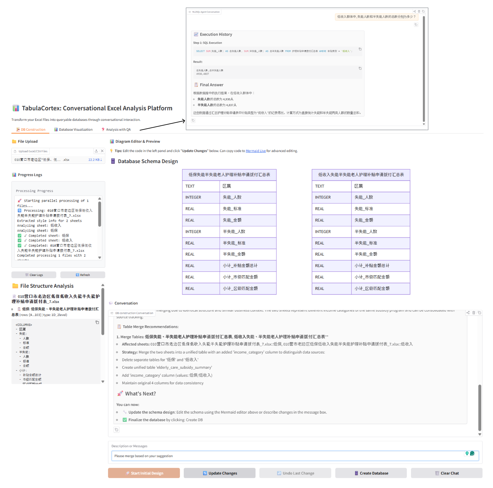

# TabulaCortex

**Conversational spreadsheet-to-database analytics.** Upload Excel/CSV files, design a unified relational schema through dialogue, build a SQLite database, and then ask analytical questions in natural language.



[Presentation slides (PDF)](assets/TabulaCortex.pdf)

> Research demo, not a hosted service. The full flow needs an OpenAI-compatible LLM endpoint. No offline/CPU-only mode is claimed.

## What it does

**Phase 1 — Interactive database construction**
- Upload one or more `.xlsx` / `.xls` / `.csv` files.
- Infer sheet structure, including multi-row and nested headers and footer metadata.
- Agents propose a merged relational schema, column mappings and foreign keys.
- Review/edit the schema as a Mermaid ER diagram, or describe changes in chat.
- Create a SQLite database from the agreed schema.

**Phase 2 — Conversational analysis (NL2SQL)**
- Select a generated database.
- A tool-calling agent inspects the schema, generates SQL, executes it, and returns an answer with the result table.
- Execution history and the raw result CSV are available in the UI.

## Quick start

Requirements: Python 3.10+ (current `smolagents`/`gradio` releases require it) and an OpenAI-compatible model endpoint.

```bash
python3 -m pip install -r requirements.txt
cp .env.example .env
# edit .env: MODEL_NAME, BASE_URL, API_KEY
python app.py
```

Then open <http://127.0.0.1:7860>.

`app.py` is a thin launcher that changes to the repository root before importing the original UI, because prompt templates are loaded with cwd-relative paths. Running `python UI_launch_log.py` from the repository root also works. `python app.py` is the recommended entry point.

No `.env` with real credentials is included. If the endpoint is missing or misconfigured, model-backed steps will fail with an API error; the UI itself can still start.

## Synthetic example

`examples/sales.xlsx` is fully fictional: two sheets (`sales_2025`, `regions`), Chinese headers, a title/metadata row and a footer row. Regenerate it with:

```bash
python examples/make_sample_workbook.py
```

Reproducible prompts and expected outputs are in [`examples/example_queries.md`](examples/example_queries.md).

## Repository layout

| Path | Purpose |
| --- | --- |
| `app.py` | Thin launcher for the Gradio UI |
| `UI_launch_log.py` | Gradio UI: upload, schema editor, DB creation, NL2SQL chat |
| `workflow_DBconstruct.py` | Orchestrates parsing, schema design/update and SQLite creation |
| `workflow_NL2SQL.py` | NL2SQL agent, SQL execution and result handling |
| `UnderstandExcel/` | Excel/CSV parsing and update logic |
| `DesignDBschema/` | Initial design, merge advice and schema updates |
| `CreateDB/` | SQLite DDL generation and cell reformatting |
| `general_agents/` | Shared response/scheduler agents |
| `templates/` | Prompt templates used by the agents |
| `SystemState.py`, `ProgressLogger.py` | Session state singleton and progress logging |
| `assets/` | Screenshot and presentation slides from the public archive |
| `examples/`, `docs/`, `tests/` | Synthetic data, documentation and static checks |

## Origin and attribution

Built on [smolagents](https://github.com/huggingface/smolagents), [Gradio](https://gradio.app/), pandas and openpyxl. The screenshot and slides come from the public presentation archive; see [NOTICE.md](NOTICE.md).

## License

Code and prompt templates are MIT licensed ([LICENSE](LICENSE)). Screenshots, slides and third-party components are covered by [NOTICE.md](NOTICE.md) instead.

## Documentation

- [Architecture](docs/architecture.md)
- [User guide](docs/user-guide.md)
