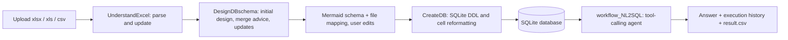

# Architecture

## End-to-end flow

## Call chain

**Database construction**
`UI_launch_log.py` → `DBConstructionWorkflow` (`workflow_DBconstruct.py`) →
`InitialParser` / `UpdaterParse` (`UnderstandExcel/`) →
`InitialDesigner` / `MergeAdvisor` / `UpdaterSchema` (`DesignDBschema/`) →
`SQLiteCreator` (`CreateDB/Prepare_sqlite.py`) → `created_DBs/`.

**Question answering**
`UI_launch_log.py` → `nl2sql_workflow` (`workflow_NL2SQL.py`) → `NL2SQLAgent` →
schema introspection (`sqlite_master`, `PRAGMA table_info`) → `exec_sql` →
answer preparation. Results are also saved to `result.csv` in the current working directory.

## Module responsibilities

| Module | Responsibility |
| --- | --- |
| `UI_launch_log.py` | Gradio blocks, upload handling, progress logs, schema editor, DB selector, chat |
| `workflow_DBconstruct.py` | Step orchestration and Markdown/Mermaid visualization helpers |
| `workflow_NL2SQL.py` | Agent loop, tool parsing, SQL execution, schema/sample readers |
| `UnderstandExcel/InitialParser.py` | First-pass sheet parsing and schema extraction prompt |
| `UnderstandExcel/Updater_Parse.py` | Re-parsing after user changes |
| `DesignDBschema/InitialDesigner.py` | Column mapping and table DDL proposal |
| `DesignDBschema/MergeAdvisor.py` | Cross-sheet merge suggestions |
| `DesignDBschema/Updater_Schema.py` | Tool-driven schema edits (create/delete/merge, foreign keys) |
| `CreateDB/Prepare_sqlite.py` | Build SQLite tables and load transformed rows |
| `CreateDB/reformat_helpers.py` | Cell/type coercion helpers |
| `general_agents/` | Response formatting and step scheduling helpers |
| `SystemState.py` | Global singleton holding uploaded files, history and workflow state |
| `ProgressLogger.py` | Thread-safe progress callback log |

## Configuration and paths

- Model config is read with `os.getenv` / `python-dotenv`: `MODEL_NAME`, `BASE_URL`, `API_KEY`.
- Prompt templates are read with cwd-relative paths (for example `templates/template_extractSchema.txt`). `app.py` changes the cwd to the repository root so these resolve correctly.
- Runtime output folders: `uploads/`, `temp/`, `created_DBs/`; all are gitignored.
- `workflow_NL2SQL.py` also looks for `*.csv` in the current directory as optional "not-for-db" files. Keep the working directory clean when running the demo.
